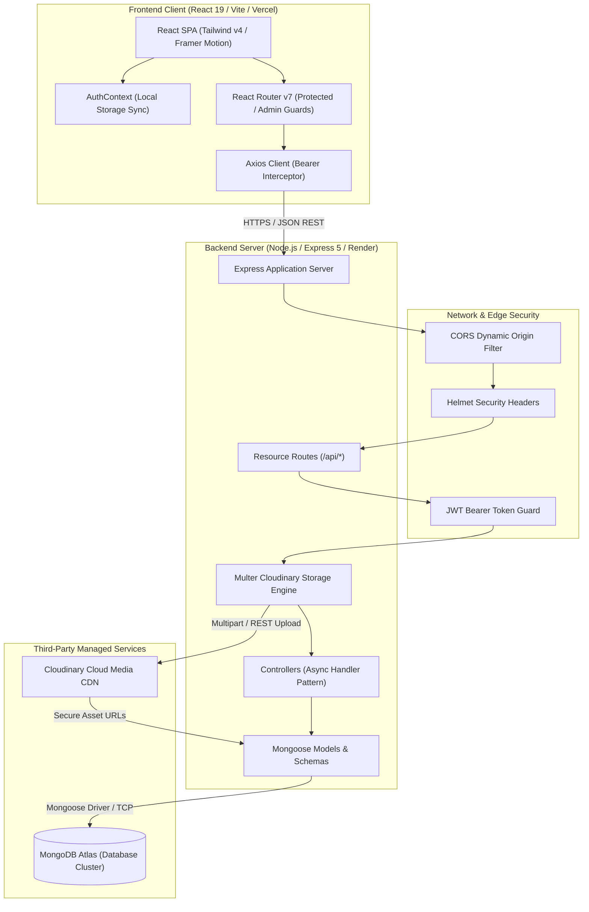
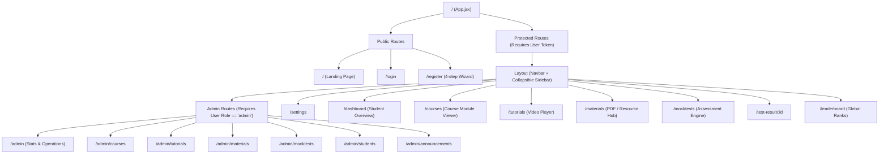
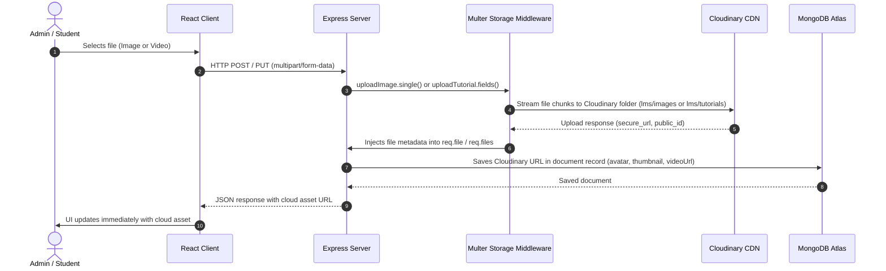
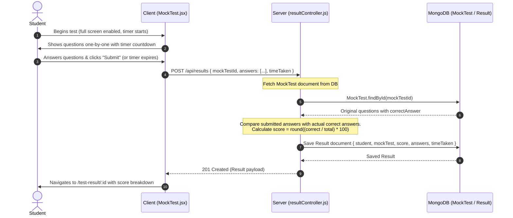
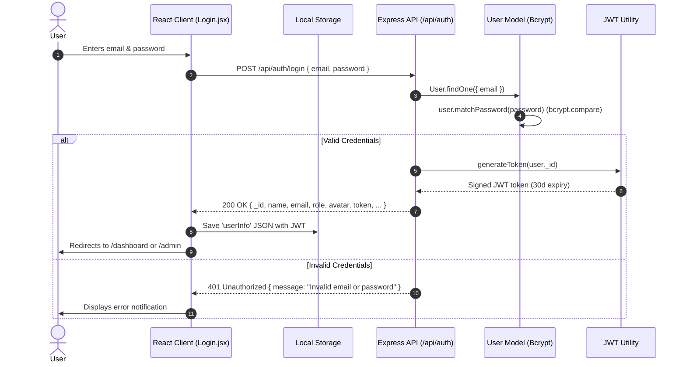

# LMS Cloud Sai — System Architecture

This document provides a comprehensive technical breakdown of the architecture, design patterns, component interactions, and data flows of the **LMS Cloud Sai** platform.

---

## 1. High-Level System Architecture

LMS Cloud Sai follows a decoupled, client-server architecture. The frontend is a Single-Page Application (SPA) built with React 19 and Vite, deployed on edge CDN infrastructure (Vercel). The backend is a stateless Node.js/Express REST API hosted on Render, communicating with MongoDB Atlas for persistent document storage and Cloudinary for media assets.



---

## 2. Frontend Architecture (Client Tier)

### 2.1 Technology Stack & Structure
- **Framework**: React 19 (`react`, `react-dom`) using functional components, custom hooks, and concurrent features.
- **Routing**: React Router DOM v7 (`react-router-dom`) with declarative layout nesting.
- **Styling**: Tailwind CSS v4 configured via `@tailwindcss/vite` and `@tailwindcss/postcss` with custom theme variables defined in [index.css](file:///e:/DEVELOPMENT/projects/lms/client/src/index.css).
- **Animation**: Framer Motion v12 (`framer-motion`) powering page exit/enter transitions (`AnimatePresence`), floating hero elements, and interactive modals.
- **Notifications**: `react-hot-toast` for non-blocking feedback across user flows.

### 2.2 Route Hierarchy & Access Control

The client enforces strict two-tiered route protection:


#### Route Guard Implementations:
1. **[ProtectedRoute.jsx](file:///e:/DEVELOPMENT/projects/lms/client/src/components/routes/ProtectedRoute.jsx)**:
   - Reads `user` state and `loading` status from `AuthContext`.
   - Displays a central spinner during token rehydration.
   - Redirects unauthenticated sessions directly to `/login`.
2. **[AdminRoute.jsx](file:///e:/DEVELOPMENT/projects/lms/client/src/components/routes/AdminRoute.jsx)**:
   - Evaluates `user?.role === 'admin'`.
   - Non-admin authenticated sessions are redirected to `/dashboard`.

### 2.3 State Management & HTTP Communication
- **[AuthContext.jsx](file:///e:/DEVELOPMENT/projects/lms/client/src/context/AuthContext.jsx)**:
  - Manages `user` state initialized from `localStorage.getItem('userInfo')`.
  - On mount, triggers an auto-login validation against `GET /api/auth/me`. If invalid or expired, gracefully clears storage.
  - Exposes `login`, `register`, `updateProfile`, and `logout` actions wrapped with toast alerts.
- **[api.js (Axios Instance)](file:///e:/DEVELOPMENT/projects/lms/client/src/services/api.js)**:
  - Configures `baseURL` using Vite environment variables (`import.meta.env.VITE_API_URL` or fallback `http://localhost:5000/api`).
  - **Request Interceptor**: Extracts JWT from `localStorage` and injects `Authorization: Bearer <token>` into outbound headers.
  - **Response Interceptor**: Intercepts `401 Unauthorized` responses to clear local credentials and prevent stale session looping.
- **[useFetch.js Hook](file:///e:/DEVELOPMENT/projects/lms/client/src/hooks/useFetch.js)**:
  - Standardized custom hook encapsulating `loading` and `error` flags with dynamic HTTP method dispatching (`get`, `post`, `put`, `delete`).

---

## 3. Backend Architecture (Server Tier)

### 3.1 Layered MVC Pattern
The backend is organized into cleanly delineated concerns:

```
Request ➡️ [server.js] ➡️ [Middleware Pipeline] ➡️ [Router] ➡️ [Controller] ➡️ [Mongoose Model] ➡️ MongoDB
```

1. **Bootstrap & Server Entry ([server.js](file:///e:/DEVELOPMENT/projects/lms/server/server.js))**:
   - Initializes environment variables (`dotenv.config()`).
   - Connects to database cluster via [config/db.js](file:///e:/DEVELOPMENT/projects/lms/server/config/db.js).
   - Mounts middleware, health endpoint (`/api/health`), and modular resource routers.
   - Registers fallback 404 and global error handler middleware.
2. **Middleware Pipeline**:
   - **CORS Handler**: Dynamically matches caller origins against allowed list (`localhost:5173`, `localhost:3000`, and all `*.vercel.app` domains).
   - **Security Headers**: `helmet()` sets standard HTTP security headers (HSTS, X-Content-Type-Options, etc.).
   - **Logging**: `morgan('dev')` in development environments.
   - **Authentication Guard ([authMiddleware.js](file:///e:/DEVELOPMENT/projects/lms/server/middleware/authMiddleware.js))**: Validates Bearer tokens with `jwt.verify()` and populates `req.user` with user record minus password.
   - **Role Guard ([authMiddleware.js](file:///e:/DEVELOPMENT/projects/lms/server/middleware/authMiddleware.js))**: Restricts administrative routes to `role === 'admin'`.
3. **Controllers Layer**:
   - Wrapped with `express-async-handler` to catch unhandled async rejections and pipe them directly into Express's error handler without repetitive `try-catch` blocks.
4. **Data Access Layer (Mongoose Models)**:
   - Schema enforcement, pre-save hooks (e.g. bcrypt password salting), document instance methods, and compound indexes.

---

## 4. Media Storage Architecture (Cloudinary Pipeline)

The platform delegates all binary assets (images, profile avatars, PDFs, and video tutorials) to Cloudinary to keep the application tier stateless:



### Storage Engines Defined in [uploadMiddleware.js](file:///e:/DEVELOPMENT/projects/lms/server/middleware/uploadMiddleware.js):
- `imageStorage`: Stores in folder `lms/images`, restricts to `jpg`, `png`, `jpeg`, `webp`, and applies automatic resizing transformation (`width: 1200, height: 675, crop: 'limit'`).
- `tutorialStorage`: Stores in folder `lms/tutorials` with `resource_type: 'auto'` to permit both video MP4/WebM uploads and companion thumbnail images.

---

## 5. Assessment & Gamification Engine

The platform features an automated assessment pipeline that evaluates student submissions server-side to guarantee integrity.



### Leaderboard Aggregation Pipeline
The leaderboard endpoint (`GET /api/results/leaderboard`) uses MongoDB's aggregation engine in [resultController.js](file:///e:/DEVELOPMENT/projects/lms/server/controllers/resultController.js#L69-L102):
1. **`$group`**: Groups all result records by `student` ObjectId, computing `$avg: '$score'` and `$sum: 1` as `testsTaken`.
2. **`$sort`**: Orders by `avgScore` descending.
3. **`$limit`**: Takes the top 10 ranked candidates.
4. **`$lookup`**: Performs a left outer join with the `users` collection to resolve candidate name and avatar.
5. **`$unwind`**: Deconstructs the joined student array.
6. **`$project`**: Sanitizes the response payload, ensuring sensitive fields (passwords, emails) are excluded.

---

## 6. End-to-End Authentication Architecture



---

## 7. Security Architecture

1. **Password Encryption**: All user passwords are automatically encrypted via a Mongoose `pre('save')` hook using `bcryptjs` with 10 salt rounds. Plaintext passwords never persist to storage.
2. **Stateless Authorization**: JWT tokens are signed using HMAC SHA-256 (`process.env.JWT_SECRET`) with an expiration period. Tokens are validated per request via HTTP Authorization headers (`Bearer <token>`).
3. **HTTP Header Hardening**: Helmet middleware sets secure HTTP headers:
   - DNS prefetch control
   - Frameguard (clickjacking mitigation)
   - Hide powered-by header
   - HSTS (Strict Transport Security)
   - IE No Open
   - MIME type sniffing prevention (`X-Content-Type-Options: nosniff`)
   - XSS Filter
4. **CORS Isolation**: The server strictly validates incoming `Origin` headers, allowing whitelisted development hosts, production frontend URLs, and `.vercel.app` subdomains while rejecting arbitrary external origins.
5. **Role-Based Access Isolation**: Any destructive administrative action (course creation, test authoring, announcement management) passes through the combined `protect` and `admin` middleware chain.
