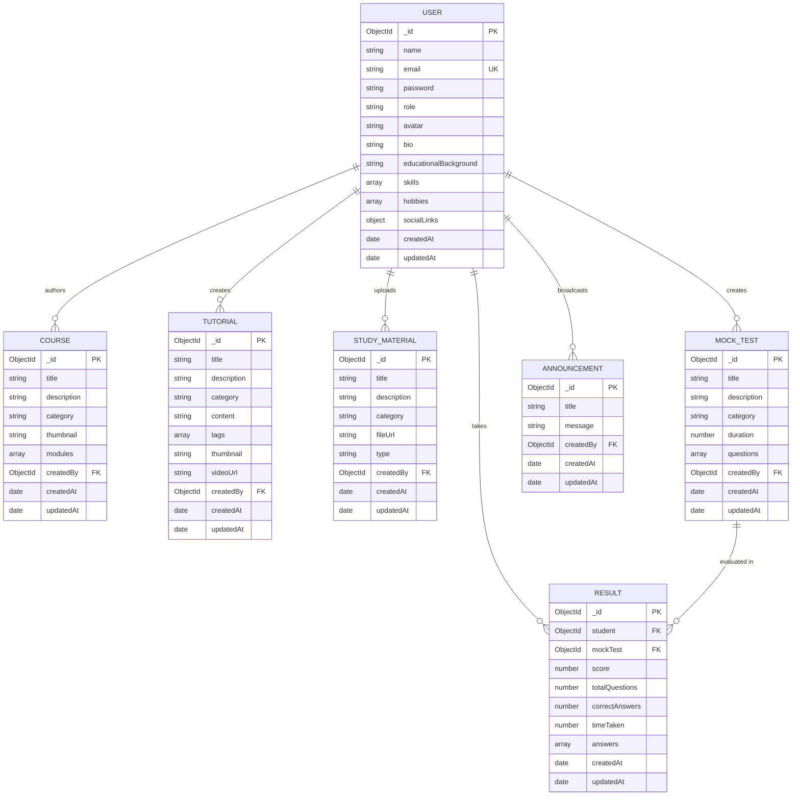

# LMS Cloud Sai — Database Schema & Data Models

LMS Cloud Sai uses **MongoDB Atlas** with **Mongoose ODM** (`v9.4.1`) for document persistence, relational population, schema validation, and aggregation pipelines.

---

## 1. Entity-Relationship (ER) Diagram



---

## 2. Collection Schemas in Detail

### 2.1 Users Collection ([models/User.js](file:///e:/DEVELOPMENT/projects/lms/server/models/User.js))

Stores authentication credentials, user role, and developer identity data.

| Field | Type | Required | Default | Description |
| :--- | :--- | :--- | :--- | :--- |
| `name` | String | Yes | — | Student/Admin full name |
| `email` | String | Yes | — | Normalized, lowercase, trimmed, unique index |
| `password` | String | Yes | — | Min length 6; auto-hashed via bcrypt pre-save hook |
| `role` | String | No | `'student'` | Enum: `['admin', 'student']` |
| `avatar` | String | No | DiceBear SVG | Cloudinary image URL or default SVG avatar |
| `bio` | String | No | `''` | Short biography/about me |
| `educationalBackground` | String | No | `''` | School, university, or institute |
| `skills` | `[String]` | No | `[]` | Technical tags (e.g., `["React", "Node.js"]`) |
| `hobbies` | `[String]` | No | `[]` | Personal interests |
| `socialLinks.github` | String | No | `''` | GitHub profile URL |
| `socialLinks.hackerrank` | String | No | `''` | HackerRank profile URL |
| `socialLinks.linkedin` | String | No | `''` | LinkedIn profile URL |

#### Pre-Save Middleware Hook:
```javascript
userSchema.pre('save', async function () {
  if (!this.isModified('password')) return;
  const salt = await bcrypt.genSalt(10);
  this.password = await bcrypt.hash(this.password, salt);
});
```

---

### 2.2 Courses Collection ([models/Course.js](file:///e:/DEVELOPMENT/projects/lms/server/models/Course.js))

Stores structured course tracks with embedded module subdocuments.

| Field | Type | Required | Description |
| :--- | :--- | :--- | :--- |
| `title` | String | Yes | Course title |
| `description` | String | Yes | Long-form course syllabus summary |
| `category` | String | Yes | Topic category (indexed for fast filtering) |
| `thumbnail` | String | No | Cloudinary secure URL for course graphic |
| `modules` | `[Subdocument]` | No | Embedded array of module objects |
| `modules[].title` | String | Yes | Module lesson title |
| `modules[].content`| String | Yes | Module body text or Markdown |
| `modules[].order` | Number | No (0) | Sequential index for curriculum order |
| `createdBy` | ObjectId | No | References `User` (`role: 'admin'`) |

---

### 2.3 Tutorials Collection ([models/Tutorial.js](file:///e:/DEVELOPMENT/projects/lms/server/models/Tutorial.js))

Stores standalone video tutorials and companion technical guides.

| Field | Type | Required | Description |
| :--- | :--- | :--- | :--- |
| `title` | String | Yes | Tutorial title |
| `description` | String | Yes | Brief summary of covered technical concepts |
| `category` | String | Yes | Category tag (indexed) |
| `content` | String | Yes | Technical walkthrough or code snippets |
| `tags` | `[String]` | No | Keyword search tags |
| `thumbnail` | String | No | Cloudinary thumbnail preview image |
| `videoUrl` | String | No | Cloudinary MP4/WebM video stream URL |
| `createdBy` | ObjectId | No | References `User` |

---

### 2.4 Study Materials Collection ([models/StudyMaterial.js](file:///e:/DEVELOPMENT/projects/lms/server/models/StudyMaterial.js))

Stores downloadable documentation, cheat sheets, and external reference links.

| Field | Type | Required | Description |
| :--- | :--- | :--- | :--- |
| `title` | String | Yes | Material name |
| `description` | String | Yes | Resource description |
| `category` | String | Yes | Subject category (indexed) |
| `fileUrl` | String | Yes | Hosted PDF link, drive URL, or web link |
| `type` | String | No (`'pdf'`) | Enum: `['pdf', 'link', 'notes']` |
| `createdBy` | ObjectId | No | References `User` |

---

### 2.5 Mock Tests Collection ([models/MockTest.js](file:///e:/DEVELOPMENT/projects/lms/server/models/MockTest.js))

Defines assessments, time constraints, and question pools with answer keys.

| Field | Type | Required | Description |
| :--- | :--- | :--- | :--- |
| `title` | String | Yes | Test title |
| `description` | String | Yes | Test scope description |
| `category` | String | Yes | Assessment topic (indexed) |
| `duration` | Number | Yes | Time limit in minutes |
| `questions` | `[Subdocument]` | Yes | Array of question objects |
| `questions[].questionText` | String | Yes | Assessment prompt |
| `questions[].options` | `[String]` | Yes | 4 multiple choice options |
| `questions[].correctAnswer` | String | Yes | Exact text of the correct choice |
| `questions[].explanation` | String | No | Rationale shown during review |
| `createdBy` | ObjectId | No | References `User` |

---

### 2.6 Results Collection ([models/Result.js](file:///e:/DEVELOPMENT/projects/lms/server/models/Result.js))

Records student assessment submissions, calculated performance scores, and response integrity.

| Field | Type | Required | Description |
| :--- | :--- | :--- | :--- |
| `student` | ObjectId | Yes | References `User` (indexed) |
| `mockTest` | ObjectId | Yes | References `MockTest` (indexed) |
| `score` | Number | Yes | Calculated percentage ($0 - 100$) |
| `totalQuestions` | Number | Yes | Question count of the test |
| `correctAnswers` | Number | Yes | Number of correct selections |
| `timeTaken` | Number | No | Total elapsed test time in seconds |
| `answers` | `[Subdocument]` | No | Array of evaluated answers |
| `answers[].questionIndex` | Number | No | 0-based question pointer |
| `answers[].selectedOption` | String | No | Option chosen by candidate |
| `answers[].isCorrect` | Boolean | No | Verification result computed server-side |

---

### 2.7 Announcements Collection ([models/Announcement.js](file:///e:/DEVELOPMENT/projects/lms/server/models/Announcement.js))

Stores system-wide announcements broadcasted to all students.

| Field | Type | Required | Description |
| :--- | :--- | :--- | :--- |
| `title` | String | Yes | Announcement headline |
| `message` | String | Yes | Detailed body text |
| `createdBy` | ObjectId | No | References `User` (Admin) |

---

## 3. Indexing & Optimization Strategy

To maintain sub-100ms response times as user records and test submissions scale, explicit indexes are declared across critical lookup paths:

1. **`User.email`**: `{ unique: true, index: true }` — Guarantees credential uniqueness and powers $O(1)$ login lookups.
2. **`Course.category`**, **`Tutorial.category`**, **`StudyMaterial.category`**, **`MockTest.category`**: `{ index: true }` — Enables instant category-filtered catalog browsing.
3. **`Result.student` & `Result.mockTest`**: `{ index: true }` — Optimizes student result history queries and leaderboard aggregation pipeline runs.

---

## 4. Leaderboard Aggregation Deep Dive

The global leaderboard is computed in real time without storing denormalized leaderboard tables, using MongoDB's aggregation engine in [resultController.js](file:///e:/DEVELOPMENT/projects/lms/server/controllers/resultController.js):

```javascript
const leaderboard = await Result.aggregate([
  // 1. Group all test attempts by student ObjectId
  {
    $group: {
      _id: '$student',
      avgScore: { $avg: '$score' },
      testsTaken: { $sum: 1 },
    },
  },
  // 2. Rank candidates by highest average score
  { $sort: { avgScore: -1 } },
  // 3. Keep top 10 candidates
  { $limit: 10 },
  // 4. Join user details from the 'users' collection
  {
    $lookup: {
      from: 'users',
      localField: '_id',
      foreignField: '_id',
      as: 'studentInfo',
    },
  },
  // 5. Flatten the joined student array
  { $unwind: '$studentInfo' },
  // 6. Project only public fields (name, avatar, stats)
  {
    $project: {
      _id: 1,
      avgScore: 1,
      testsTaken: 1,
      'studentInfo.name': 1,
      'studentInfo.avatar': 1,
    },
  },
]);
```
