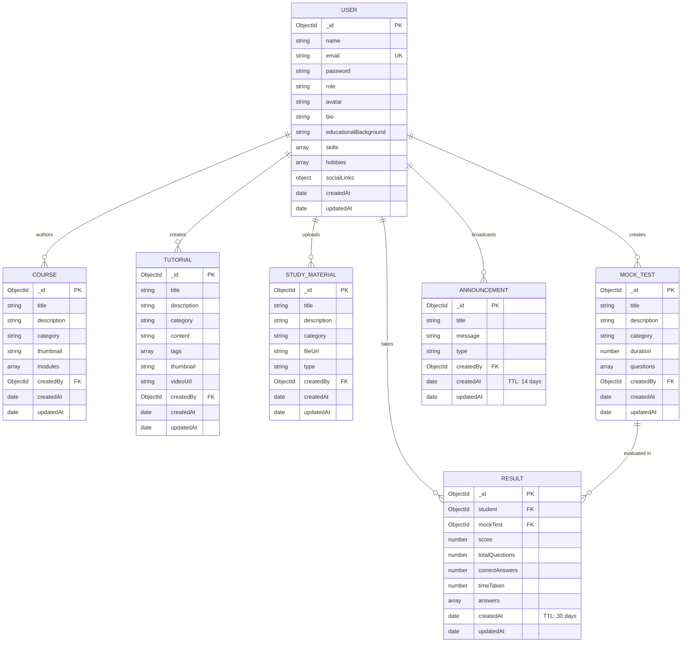

# LMS Cloud Sai — Database Schema & Data Models

LMS Cloud Sai uses **MongoDB Atlas** with **Mongoose ODM** (`v9.4.1`) for document persistence, relational population, schema validation, aggregation pipelines, and automated storage budget preservation.

---

## 1. Entity-Relationship (ER) Diagram



---

## 2. Collection Specifications & Data Models

### 2.1 User Model (`users`)
* **Primary Key:** `_id` (ObjectId)
* **Indexes:**
  * `email` (Unique, Sparse)
* **Fields:**
  * `name` (String, Required, Trimmed)
  * `email` (String, Required, Lowercase, Validated via RFC 5322 regex)
  * `password` (String, Required, Bcrypt hashed, Select: false by default)
  * `role` (String, Enum: `['admin', 'student']`, Default: `'student'`)
  * `avatar` (String, Cloudinary CDN URL)
  * `bio` (String, Max 500 characters)
  * `educationalBackground` (String)
  * `skills` ([String])
  * `hobbies` ([String])
  * `socialLinks` (Object: `{ github: String, hackerrank: String, linkedin: String }`)
  * `timestamps` (`createdAt`, `updatedAt`)

### 2.2 Course Model (`courses`)
* **Primary Key:** `_id` (ObjectId)
* **Fields:**
  * `title` (String, Required, Trimmed)
  * `description` (String, Required)
  * `category` (String, Required, e.g., 'DSA', 'Full Stack', 'Cloud')
  * `thumbnail` (String, Cloudinary image URL)
  * `modules` (Array of embedded subdocuments: `[{ title: String, content: String }]`)
  * `createdBy` (ObjectId referencing `User`)

### 2.3 Tutorial Model (`tutorials`)
* **Primary Key:** `_id` (ObjectId)
* **Fields:**
  * `title` (String, Required)
  * `description` (String, Required)
  * `category` (String, Required)
  * `content` (String, Markdown/HTML tutorial text)
  * `tags` ([String])
  * `thumbnail` (String, Cloudinary image URL)
  * `videoUrl` (String, Cloudinary video URL)
  * `createdBy` (ObjectId referencing `User`)

### 2.4 Study Material Model (`studymaterials`)
* **Primary Key:** `_id` (ObjectId)
* **Fields:**
  * `title` (String, Required)
  * `description` (String)
  * `category` (String, Required)
  * `fileUrl` (String, Cloudinary PDF or external link)
  * `type` (String, Enum: `['pdf', 'link', 'notes']`, Required)
  * `createdBy` (ObjectId referencing `User`)

### 2.5 Mock Test Model (`mocktests`)
* **Primary Key:** `_id` (ObjectId)
* **Fields:**
  * `title` (String, Required)
  * `description` (String)
  * `category` (String, Required)
  * `duration` (Number, Duration in minutes)
  * `questions` (Array of question subdocuments: `[{ questionText: String, options: [String], correctAnswer: String, explanation: String }]`)
  * `createdBy` (ObjectId referencing `User`)

### 2.6 Result Model (`results`) — With TTL Auto-Eviction
* **Primary Key:** `_id` (ObjectId)
* **Indexes:**
  * `{ student: 1, createdAt: -1 }` (Compound index for student performance histories)
  * `{ createdAt: 1 }` with `{ expireAfterSeconds: 2592000 }` (**30-day TTL index**)
* **Fields:**
  * `student` (ObjectId referencing `User`, Required)
  * `mockTest` (ObjectId referencing `MockTest`, Required)
  * `score` (Number, 0–100 percentage)
  * `totalQuestions` (Number)
  * `correctAnswers` (Number)
  * `timeTaken` (Number, Elapsed seconds)
  * `answers` (`[{ questionIndex: Number, selectedOption: String, isCorrect: Boolean }]`)

### 2.7 Announcement Model (`announcements`) — With TTL Auto-Eviction
* **Primary Key:** `_id` (ObjectId)
* **Indexes:**
  * `{ createdAt: 1 }` with `{ expireAfterSeconds: 1209600 }` (**14-day TTL index**)
* **Fields:**
  * `title` (String, Required)
  * `message` (String, Required)
  * `type` (String, Enum: `['info', 'warning', 'success', 'urgent']`, Default: `'info'`)
  * `createdBy` (ObjectId referencing `User`)

---

## 3. Storage Optimization & Free-Tier Longevity Architecture

Because the demonstration environment operates on MongoDB Atlas M0 (512MB hard storage quota), automated retention policies prevent quota exhaustion without requiring periodic manual database maintenance:

### 3.1 MongoDB Atlas Native TTL Eviction
* High-volume transient collections (`results` and `announcements`) utilize MongoDB's native background TTL index threads (running every 60 seconds).
* Documents past their lifespan are automatically dropped from disk and memory, maintaining constant bounded storage footprints.

### 3.2 Automated Storage Guarding (`dbStorageGuard.js`)
* The utility script [server/utils/dbStorageGuard.js](file:///e:/DEVELOPMENT/projects/lms/server/utils/dbStorageGuard.js) calculates live storage consumption via the MongoDB `dbStats` command:
  * Measures data size, index size, and total storage allocation.
  * Alerts if storage utilization exceeds 75% of the 512MB free tier budget.

### 3.3 Anti-Dormancy & Socket Keep-Alive Ping
* Cloud firewall NAT routers (AWS/GCP edge gateways) silently drop idle TCP connections after 60–120 seconds of inactivity.
* [server/server.js](file:///e:/DEVELOPMENT/projects/lms/server/server.js) runs an active database ping every 45 seconds:
  ```javascript
  setInterval(async () => {
    if (mongoose.connection.readyState === 1 && mongoose.connection.db) {
      await mongoose.connection.db.command({ ping: 1 });
    }
  }, 45 * 1000);
  ```
  This keeps socket buffers hot, prevents stale connection errors, and guarantees instantaneous query responses for student sessions.

---

## 4. Leaderboard Aggregation Deep Dive

The global student leaderboard is computed on-demand via MongoDB's aggregation pipeline in [resultController.js](file:///e:/DEVELOPMENT/projects/lms/server/controllers/resultController.js):

```javascript
const leaderboard = await Result.aggregate([
  // 1. Group mock test attempts by student ObjectId
  {
    $group: {
      _id: '$student',
      avgScore: { $avg: '$score' },
      testsTaken: { $sum: 1 },
    },
  },
  // 2. Rank candidates by highest average score
  { $sort: { avgScore: -1 } },
  // 3. Keep top 10 candidates
  { $limit: 10 },
  // 4. Join user details from the 'users' collection
  {
    $lookup: {
      from: 'users',
      localField: '_id',
      foreignField: '_id',
      as: 'studentInfo',
    },
  },
  // 5. Flatten the joined student array
  { $unwind: '$studentInfo' },
  // 6. Project only public fields (name, avatar, stats)
  {
    $project: {
      _id: 1,
      avgScore: 1,
      testsTaken: 1,
      'studentInfo.name': 1,
      'studentInfo.avatar': 1,
    },
  },
]);
```
