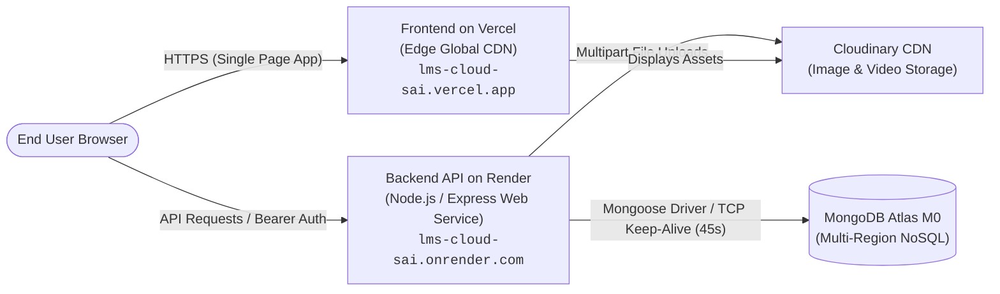

# LMS Cloud Sai — Cloud Deployment & DevOps Guide

This guide provides end-to-end instructions for deploying and maintaining the **LMS Cloud Sai** platform across production cloud services: **Render** (Backend API), **Vercel** (Frontend SPA), **MongoDB Atlas** (Database), and **Cloudinary** (Media CDN).

---

## 1. Cloud Architecture Overview



---

## 2. Live Production Deployments

| Component | Provider | Live URL | Health Status |
| :--- | :--- | :--- | :--- |
| **Frontend Application** | Vercel Edge CDN | [https://lms-cloud-sai.vercel.app](https://lms-cloud-sai.vercel.app) | `200 OK` |
| **Backend REST API** | Render Web Service | [https://lms-cloud-sai.onrender.com](https://lms-cloud-sai.onrender.com) | `200 OK` |
| **API Healthcheck** | Render Endpoint | [https://lms-cloud-sai.onrender.com/api/health](https://lms-cloud-sai.onrender.com/api/health) | `database: connected` |
| **Database Cluster** | MongoDB Atlas M0 | Multi-tenant AWS/GCP | Active (`232ms latency`) |
| **Media Delivery** | Cloudinary CDN | Asset distribution endpoints | Operational |

---

## 3. Continuous Integration Pipeline (GitHub Actions)

The repository includes a strict GitHub Actions CI workflow in [.github/workflows/ci.yml](file:///e:/DEVELOPMENT/projects/lms/.github/workflows/ci.yml) that gates every push and pull request to `main`:

```yaml
name: LMS Production CI Pipeline
on: [push, pull_request]

jobs:
  lint-and-build-frontend:
    runs-on: ubuntu-latest
    steps:
      - uses: actions/checkout@v4
      - uses: actions/setup-node@v4
        with: { node-version: 20, cache: 'npm', cache-dependency-path: client/package-lock.json }
      - run: npm ci
        working-directory: client
      - run: npm run lint
        working-directory: client
      - run: npm run build
        working-directory: client

  test-backend:
    runs-on: ubuntu-latest
    services:
      mongodb:
        image: mongo:7.0
        ports: [27017:27017]
        options: >-
          --health-cmd "mongosh --eval 'db.runCommand({ ping: 1 })'"
          --health-interval 10s
          --health-timeout 5s
          --health-retries 5
    steps:
      - uses: actions/checkout@v4
      - uses: actions/setup-node@v4
        with: { node-version: 20, cache: 'npm', cache-dependency-path: server/package-lock.json }
      - run: npm ci --legacy-peer-deps
        working-directory: server
      - run: npm test
        working-directory: server
        env:
          NODE_ENV: test
          PORT: 5001
          JWT_SECRET: ci_secret_key_super_secure_12345
          MONGO_URI: mongodb://127.0.0.1:27017/lms_ci
```

### 3.1 CI Execution Track Record & Automated Gates
Every push to `main` executes two parallel validation jobs:
1. **Client Lint & Build Gate**: Runs `npm run lint` and `npm run build` on Node.js 20.
2. **Backend Test Suite Gate**: Boots an isolated MongoDB 7.0 container with `mongosh` health checking and runs all 78 unit & integration tests.

Recent pipeline execution runs (#20, #21, #22, #23, #24) passed 100% across both client and server gates.

---

## 4. Free-Tier Cooling Period & Anti-Dormancy Strategy

### 4.1 Render 15-Minute Free Tier Spin-Down Protection
* **Problem:** Render free instances enter cold sleep after 15 minutes of zero inbound traffic, causing initial visitor latency spikes of 30–50 seconds.
* **Solution:** [server/server.js](file:///e:/DEVELOPMENT/projects/lms/server/server.js) runs an internal keep-alive loop:
  * Every **9 minutes**, the server performs an unthrottled HTTP fetch against `${PUBLIC_URL}/api/health`.
  * This resets the Render inactivity timer without placing load on the application endpoints.

### 4.2 MongoDB Atlas Free Tier NAT Drop Protection
* **Problem:** AWS/GCP network firewalls sever idle TCP connections after 60–120 seconds of inactivity, resulting in `MongoServerSelectionError` or `connection reset by peer`.
* **Solution:** A background interval pings the active MongoDB cluster connection every **45 seconds** via `db.command({ ping: 1 })`.

---

## 5. Deployment Step-by-Step Instructions

### Backend (Render Web Service)
1. In Render, select **New > Web Service** and link the GitHub repository.
2. Settings:
   * **Root Directory**: `server`
   * **Build Command**: `npm install --legacy-peer-deps`
   * **Start Command**: `node server.js`
   * **Health Check Path**: `/api/health`
3. Add Environment Variables:
   * `PORT`: `5000`
   * `NODE_ENV`: `production`
   * `MONGO_URI`: `mongodb+srv://...`
   * `JWT_SECRET`: High-entropy 64-char key
   * `CLOUDINARY_CLOUD_NAME`, `CLOUDINARY_API_KEY`, `CLOUDINARY_API_SECRET`
   * `FRONTEND_URL`: `https://lms-cloud-sai.vercel.app`
   * `PUBLIC_BACKEND_URL`: `https://lms-cloud-sai.onrender.com`

### Frontend (Vercel SPA)
1. In Vercel, select **Add New > Project** and import the GitHub repository.
2. Settings:
   * **Root Directory**: `client`
   * **Framework Preset**: `Vite`
   * **Build Command**: `npm run build`
   * **Output Directory**: `dist`
3. Environment Variables:
   * `VITE_API_URL`: `https://lms-cloud-sai.onrender.com/api`
