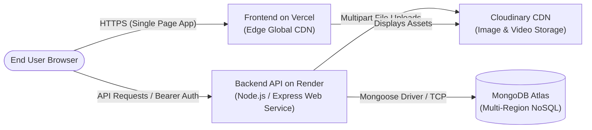

# LMS Cloud Sai — Cloud Deployment & DevOps Guide

This guide provides end-to-end instructions for deploying the **LMS Cloud Sai** platform across production cloud services: **Render** (Backend API), **Vercel** (Frontend SPA), **MongoDB Atlas** (Database), and **Cloudinary** (Media CDN).

---

## 1. Cloud Architecture Overview



---

## 2. Prerequisites & Accounts

1. **GitHub Account**: Containing the `LMS-cloud-sai` repository.
2. **MongoDB Atlas Account**: A dedicated or free M0 cluster.
3. **Cloudinary Account**: Cloud name, API key, and API secret.
4. **Render Account**: For hosting the Node.js Express server.
5. **Vercel Account**: For hosting the Vite React client.

---

## 3. Database Setup (MongoDB Atlas)

1. **Create Database Cluster**:
   - Create a shared M0 cluster on AWS/GCP in your nearest region.
2. **Configure Database User**:
   - Create a database user with `readWriteAnyDatabase` or scoped read/write permissions on `lms`.
   - Record the username and a strong alphanumeric password.
3. **Configure Network Access**:
   - In Atlas under **Network Access**, add IP address `0.0.0.0/0` (Allow Access from Anywhere) to permit Render's dynamic IP ranges to connect.
4. **Obtain Connection String**:
   - Connection format:
     ```
     mongodb+srv://<username>:<password>@cluster0.mongodb.net/lms?retryWrites=true&w=majority
     ```

---

## 4. Backend Deployment (Render)

1. **Create a New Web Service**:
   - Connect your GitHub repository to Render.
   - Choose **Web Service**.
2. **Service Configuration**:
   - **Name**: `lms-cloud-sai` (or custom name)
   - **Region**: Choose closest to your MongoDB Atlas region (e.g., Frankfurt, Singapore, Ohio)
   - **Root Directory**: `server`
   - **Runtime**: `Node`
   - **Build Command**: `npm install`
   - **Start Command**: `node server.js`
   - **Instance Type**: Free or Starter
3. **Environment Variables**:
   Under the **Environment** tab, add the following key-value pairs:

   | Key | Value Example | Description |
   | :--- | :--- | :--- |
   | `PORT` | `5000` | Internal server listen port |
   | `NODE_ENV` | `production` | Enables production optimizations |
   | `MONGO_URI` | `mongodb+srv://...` | MongoDB Atlas URI |
   | `JWT_SECRET` | `YOUR_RANDOM_LONG_SECRET_KEY` | Secret for HMAC SHA-256 JWT signing |
   | `JWT_EXPIRE` | `7d` | Token lifetime |
   | `CLOUDINARY_CLOUD_NAME`| `your_cloud_name` | Cloudinary credentials |
   | `CLOUDINARY_API_KEY` | `your_api_key` | Cloudinary API Key |
   | `CLOUDINARY_API_SECRET`| `your_api_secret` | Cloudinary API Secret |
   | `FRONTEND_URL` | `https://your-app.vercel.app` | Production frontend domain for CORS |

4. **Health Check Path**:
   - Set **Health Check Path** to `/api/health`.
5. **Deploy**:
   - Click **Create Web Service**. Once deployed, Render will provide a live URL such as `https://lms-cloud-sai.onrender.com`.

---

## 5. Frontend Deployment (Vercel)

1. **Import Repository**:
   - Go to the Vercel dashboard and click **Add New... > Project**.
   - Select your `LMS-cloud-sai` repository.
2. **Project Settings**:
   - **Framework Preset**: `Vite`
   - **Root Directory**: `client`
   - **Build Command**: `npm run build`
   - **Output Directory**: `dist`
   - **Install Command**: `npm install`
3. **Environment Variables**:
   Add the backend endpoint pointer:

   | Key | Value Example | Description |
   | :--- | :--- | :--- |
   | `VITE_API_URL` | `https://lms-cloud-sai.onrender.com/api` | Live Render backend API root |

4. **Verify SPA Rewrites**:
   Confirm that [client/vercel.json](file:///e:/DEVELOPMENT/projects/lms/client/vercel.json) exists in the client folder:
   ```json
   {
     "rewrites": [
       { "source": "/(.*)", "destination": "/index.html" }
     ]
   }
   ```
5. **Deploy**:
   - Click **Deploy**. Vercel will build the frontend assets and distribute them across edge locations.

---

## 6. Post-Deployment Verification

1. **Verify Backend Health**:
   ```bash
   curl https://lms-cloud-sai.onrender.com/api/health
   # Expected output: {"status":"ok","uptime":...}
   ```
2. **Seed Initial Accounts**:
   From your local development machine with production `.env` credentials configured:
   ```bash
   node server/seed-final.js
   ```
   This creates:
   - `admin@example.com` / `password123`
   - `student@example.com` / `password123`
3. **Run End-to-End Smoke Test Against Production**:
   Update `API_URL` in `server/smoke-test.js` or run locally to verify complete operational integrity.

---

## 7. Troubleshooting & Operational Notes

### Render Free Tier Cold Starts
- **Symptom:** The first API request after 15 minutes of inactivity takes 30-50 seconds to respond.
- **Cause:** Free-tier Render web services spin down after idling.
- **Remedy:** This is expected behavior on free tiers. For zero-downtime production, upgrade to a Render paid instance ($7/month) or configure an external uptime monitor (e.g., UptimeRobot or Cron-job.org) pinging `https://lms-cloud-sai.onrender.com/api/health` every 10 minutes.

### CORS Errors (`Not allowed by CORS`)
- **Symptom:** Browser console reports `Access to XMLHttpRequest has been blocked by CORS policy`.
- **Cause:** Request originates from a domain not matched by [server/server.js](file:///e:/DEVELOPMENT/projects/lms/server/server.js#L22-L41).
- **Remedy:** Ensure your custom domain is added to `allowedOrigins` in `server.js` or set via the `FRONTEND_URL` environment variable. Note that all `*.vercel.app` subdomains are automatically allowed by default.

### Page Refresh Returns 404 on Vercel
- **Symptom:** Direct URL navigation to `/courses` or `/dashboard` displays Vercel 404 page.
- **Cause:** Missing SPA rewrite rule.
- **Remedy:** Ensure `client/vercel.json` exists with the rewrite rule pointing all paths to `/index.html`.
