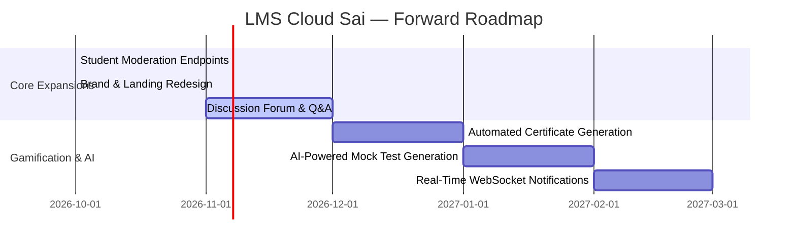

# LMS Cloud Sai — Development Phases & Milestone Roadmap

This document outlines the evolutionary phases of **LMS Cloud Sai**, detailing completed engineering milestones, current project state, and the forward-looking roadmap.

---

## 1. Phase Status Overview

| Phase | Milestone Name | Status | Completion Target |
| :--- | :--- | :--- | :--- |
| **Phase 1** | System Scaffold, Auth & Base Infrastructure | **Completed** | Foundation Release |
| **Phase 2** | Role-Based Access & Content Management | **Completed** | Alpha Release |
| **Phase 3** | Assessment Engine & Leaderboard | **Completed** | Beta Release |
| **Phase 4** | Gamified Profiles & UI Polish | **Completed** | Release Candidate |
| **Phase 5** | Production Hardening, Atlas TTL & CI/CD | **Completed** | Production v1.0.0 |
| **Phase 6** | Humanized Student Experience & Placement Arena | **Completed** | Production v1.1.0 |
| **Phase 7** | Brand Identity & Executive Landing Elevation | **Completed** | Production v1.2.0 |
| **Phase 8** | Real-Time Collaboration & AI Enhancements | **Planned** | Roadmap v2.0.0 |

---

## 2. Phase 1: Core Architecture & Platform Scaffolding (Completed)
- Monorepo / Workspace Scaffolding with root `package.json` and client/server packages.
- Express 5 API Server with body parsers, environment handling, and morgan logging.
- MongoDB Atlas connection with Mongoose ODM.
- JWT Authentication system with password hashing via bcryptjs (10 rounds).
- Vite + React 19 frontend shell.

---

## 3. Phase 2: Role-Based Content & Cloud Asset Pipeline (Completed)
- Role-Based Access Control (`role: 'admin' | 'student'`) with `protect` and `admin` guards.
- Cloudinary Storage Engine for automated image transformation and video stream hosting.
- Course, Tutorial, and Study Material CRUD management pipelines with modal editors.
- Platform Announcements broadcasting pipeline.

---

## 4. Phase 3: Assessment Engine & Gamification (Completed)
- Full-screen timed mock test environment with client countdown timer.
- Server-side assessment grading engine comparing student submissions against hidden database answer keys.
- Real-time MongoDB aggregation pipeline computing the All-India student leaderboard.

---

## 5. Phase 4: Gamified Profiles & UI Polish (Completed)
- 4-Step interactive student registration wizard (`Register.jsx`).
- Clean design system with high-contrast slate surfaces and structured cards.
- Interactive user profile settings with avatar upload previews and coding portfolio links.

---

## 6. Phase 5: Production Hardening, Atlas TTL & CI/CD Pipeline (Completed)
- **Atlas TTL Auto-Eviction**: 30-day auto-eviction on `Result` and 14-day auto-eviction on `Announcement` collections to enforce demo free-tier storage boundaries.
- **Cooling Period Resilience**:
  - Automated 9-minute Render self-ping keep-alive to reset the 15-minute container spin-down.
  - Active 45-second MongoDB database ping to keep NAT firewall sockets warm.
- **Tiered Defense-in-Depth**:
  - Dual IP + Account exponential backoff (`authBackoffMiddleware.js`).
  - Strict Zod schema validation with automatic mass-assignment rejection.
  - Custom deep NoSQL injection and prototype pollution sanitizers.
  - Runtime secret scrubbing in `errorHandler.js`.
- **CI/CD Automation**:
  - GitHub Actions pipeline (`.github/workflows/ci.yml`) running Node 20, `--legacy-peer-deps`, and MongoDB 7.0 with native `mongosh` healthcheck.
  - 78 passing automated tests across 15 suites.

---

## 7. Phase 6: Humanized Student Experience & Placement Arena (Completed)
- **Design Tokens & Micro-Interactions**:
  - Conversational, animated `EmptyState.jsx` with supportive pro-tips and instant filter resets.
  - Fast search overlay with prep streak indicators in `Navbar.jsx`.
- **Student Learning Arena**:
  - `Dashboard.jsx`: Dynamic "Placement Calibration" levels (`Explorer Mode 🌱`, `Steady Contender ⚡`, `Placement Ready 🚀`), Daily Interview Pro-Tip banner, and fixed test drive routes.
  - `Courses.jsx`: Difficulty tags, estimated mastery time (~45m per chapter), and interactive curriculum chapter checklists.
  - `Tutorials.jsx`: Video walkthrough tags, smooth play overlays, and active learning companion panel.
  - `StudyMaterials.jsx`: Resource cards distinguishing between downloadable PDF formula sheets and external links.
- **Reassuring Assessment Experience**:
  - `MockTest.jsx`: Low-stakes practice banner, color-coded timer, question navigator with answered/unanswered legend, and submission modal.
  - `TestResult.jsx`: Empathetic score feedback, per-question pacing metrics, and clear question-by-question answer keys.
  - `Leaderboard.jsx`: All-India candidate rankings with Gold, Silver, Bronze badges.
  - `Settings.jsx`: Engineer profile showcase with live skills preview tags and Argon2/Bcrypt encryption status.

---

## 8. Phase 7: Brand Identity & Executive Landing Elevation (Completed)
- **Elimination of Artificial AI-Robotic Clichés**:
  - Removed all glowing background blur orbs (`blur-[140px]`, `blur-[120px]`) and radioactive neon drop shadows across `Landing.jsx`, `Layout.jsx`, `Login.jsx`, and `Register.jsx`.
  - Replaced synthetic gradient-clipped headers with solid high-contrast white headlines (`#F8FAFC`).
  - Standardized on a grounded slate palette (`#0B0F19`, `#0F172A`, `#161F33`), classic engineering blue (`#2563EB` / `#3B82F6`), and crisp borders (`border-slate-800`).
- **Bespoke Architectural Brand Mark (`Logo.jsx`)**:
  - Replaced generic clip-art flame/bird graphics with an architectural squircle base (`#0F172A`, stroke `#334155`).
  - Precision geometric monogram intertwining an "S" with bracket vectors in `#3B82F6` and white `#FFFFFF`.
  - Solid white typography (`SaiCloud`) and clean monospace `LMS` badge (`bg-slate-800 text-slate-300 border border-slate-700`).
- **Executive Landing Stage (`Landing.jsx`)**:
  - **Sticky Engineering Header**: Clean navigation links with direct auth action buttons.
  - **Interactive Code Studio**: macOS-style window controls, file path breadcrumbs (`src/algorithms/sliding_window/Solution.java`), language switchers (Java 21, C++20, Python 3.12), line numbers (1–24), syntax highlighting, and live deterministic test runner drawer.
  - **Recruitment Standards Ticker**: Verified alignment with top employers (`Google`, `Amazon`, `Microsoft`, `Adobe`, `Flipkart`, `Uber`, `Atlassian`, `TCS Digital`).
  - **Curriculum & Evaluation Bento**: 4 curriculum tracks, 4-pillar hiring committee evaluation matrix, interactive algorithmic pattern benchmark sandbox, and interactive placement readiness audit checklist.
- **CI/CD & Live Deployment Verification**:
  - GitHub Actions CI Runs #20, #21, #22, #23, and #24 all passing 100%.
  - Production deployments confirmed live on Vercel (`https://lms-cloud-sai.vercel.app`) and Render (`https://lms-cloud-sai.onrender.com`).

---

## 9. Phase 8: Forward-Looking Roadmap (Planned)

