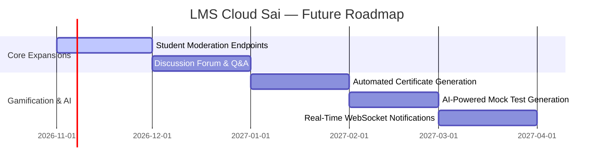

# LMS Cloud Sai — Development Phases & Milestone Roadmap

This document outlines the evolutionary phases of **LMS Cloud Sai**, detailing completed engineering milestones, current project state, and the forward-looking roadmap.

---

## 1. Phase Status Overview

| Phase | Milestone Name | Status | Completion Target |
| :--- | :--- | :--- | :--- |
| **Phase 1** | System Scaffold, Auth & Base Infrastructure | **Completed** | Foundation Release |
| **Phase 2** | Role-Based Access & Content Management | **Completed** | Alpha Release |
| **Phase 3** | Assessment Engine & Leaderboard | **Completed** | Beta Release |
| **Phase 4** | Gamified Profiles & UI Polish | **Completed** | Release Candidate |
| **Phase 5** | Production Hardening & Cloud Deployment | **Completed** | Production v1.0.0 |
| **Phase 6** | Real-Time Collaboration & AI Enhancements | **Planned** | Roadmap v2.0.0 |

---

## 2. Phase 1: Core Architecture & Platform Scaffolding (Completed)

### Objectives
Establish a robust, scalable foundation with decoupled frontend and backend services, database connectivity, and standard authentication security.

### Deliverables & Key Accomplishments
- [x] **Monorepo / Workspace Scaffolding**: Structured repository with root `package.json` utilizing `concurrently` for simultaneous client and server execution.
- [x] **Express 5 API Server**: Setup server with standard JSON body parsing, environment configuration via `dotenv`, and developer logging via `morgan`.
- [x] **MongoDB Atlas Connection**: Implemented resilient Mongoose connection logic with error logging and exit routines in `server/config/db.js`.
- [x] **JWT Authentication System**:
  - Implemented `generateToken.js` with 30-day token expiration.
  - Built `protect` middleware verifying Bearer tokens and injecting user documents.
  - Implemented user registration (`POST /api/auth/register`) and login (`POST /api/auth/login`).
  - Added Mongoose `pre('save')` hook for automated `bcryptjs` password hashing (10 rounds).
- [x] **Vite & React 19 Frontend**:
  - Configured Vite with React plugin and modern ECMAScript standards.
  - Established initial React Router tree with root layouts.

---

## 3. Phase 2: Role-Based Content & Cloud Asset Pipeline (Completed)

### Objectives
Enable administrators to manage the complete IT curriculum, incorporating cloud-based media storage for course graphics, video tutorials, and study resources.

### Deliverables & Key Accomplishments
- [x] **Role-Based Access Control (RBAC)**:
  - Added `role` attribute (`'admin' | 'student'`) to User schema.
  - Created `admin` middleware verifying administrative privileges before sensitive operations.
  - Created client-side route guards (`AdminRoute.jsx` and `ProtectedRoute.jsx`).
- [x] **Cloudinary Storage Engine**:
  - Configured Cloudinary SDK in `server/config/cloudinary.js`.
  - Built `uploadMiddleware.js` using `multer-storage-cloudinary` for automated image transformation and dual image/video handling (`resource_type: 'auto'`).
- [x] **Course Management Suite**:
  - Defined Course schema with embedded module subdocuments.
  - Implemented admin CRUD operations in `courseController.js` with thumbnail image upload.
  - Developed client admin view (`ManageCourses.jsx`) featuring modal editors and dynamic module builders.
- [x] **Tutorial Management Suite**:
  - Created Tutorial schema supporting markdown descriptions, category indexing, and tags.
  - Configured Multer fields to accept both video files and thumbnail images in a single submission.
  - Implemented admin CRUD interface in `ManageTutorials.jsx`.
- [x] **Study Materials Repository**:
  - Created StudyMaterial schema supporting `pdf`, `link`, and `notes`.
  - Built admin CRUD operations in `materialController.js` and `ManageStudyMaterial.jsx`.
- [x] **Platform Announcements System**:
  - Built announcement broadcast pipeline (`Announcement.js`, `announcementController.js`).
  - Implemented client admin panel in `Announcements.jsx`.

---

## 4. Phase 3: Assessment Engine & Gamification (Completed)

### Objectives
Build an automated, tamper-resistant examination system with real-time feedback and competitive gamification.

### Deliverables & Key Accomplishments
- [x] **Mock Test Authoring**:
  - Schema supporting title, category, test duration (in minutes), and dynamic question arrays with multiple options, correct answer keys, and explanations.
  - Admin management interface (`ManageMockTests.jsx`).
- [x] **Client-Side Testing Environment**:
  - Developed full-screen test examination mode in `MockTest.jsx`.
  - Client countdown timer synchronized with test duration.
  - Question-by-question navigation with radio answer selection.
  - Automated submission trigger upon timer expiration.
- [x] **Server-Side Grading Engine**:
  - Built automated evaluation pipeline in `resultController.js`:
    - Compares submitted option index against database correct answers.
    - Computes overall score percentage: $\text{round}((\text{correct} / \text{total}) \times 100)$.
    - Records question-by-question correctness in Result document.
- [x] **Result Review & Breakdown**:
  - Developed `TestResult.jsx` showcasing final score percentage, correct/total count, and time taken.
- [x] **Global Leaderboard Aggregation**:
  - Implemented MongoDB aggregation pipeline grouping by student, calculating average score, sorting, and joining student info.
  - Built `Leaderboard.jsx` displaying Top 3 podium medals (Gold, Silver, Bronze) and ranked student lists.

---

## 5. Phase 4: Gamified Profiles & UI Polish (Completed)

### Objectives
Elevate user engagement with an immersive dark-mode aesthetic, micro-animations, and rich developer identity capture.

### Deliverables & Key Accomplishments
- [x] **4-Step Registration Wizard**:
  - Multi-step interactive registration in `Register.jsx` with animated step transitions and top progress meter.
  - Expanded User schema to store bio, educational background, skills array, hobbies, and social links (GitHub, HackerRank, LinkedIn).
- [x] **Cyber-Dark Design System**:
  - Implemented Tailwind v4 tokens (`--color-background`, `--color-card`, `--color-accent`).
  - Added utility classes for glassmorphism (`.glass-card`), neon buttons (`.btn-primary`), and inputs (`.input-field`).
- [x] **Profile & Settings Suite**:
  - Built `Settings.jsx` supporting multipart profile editing.
  - Live client-side image preview and Cloudinary avatar storage.
- [x] **Component Reliability & UX**:
  - Created `SkeletonLoader.jsx` to prevent layout shifts.
  - Created `EmptyState.jsx` for zero-state data representation.
  - Created `ErrorBoundary.jsx` to catch runtime rendering errors.

---

## 6. Phase 5: Production Hardening & Cloud Deployment (Completed)

### Objectives
Secure, optimize, and deploy the entire platform to cloud infrastructure with continuous deployment.

### Deliverables & Key Accomplishments
- [x] **Security Hardening**:
  - Integrated Helmet security headers in Express.
  - Implemented dynamic CORS origin validation supporting development hosts and any `*.vercel.app` domain.
- [x] **SPA Deployment Optimization**:
  - Added `client/vercel.json` rewrite rule to redirect all routes to `index.html` for client-side routing.
  - Established `.env.production` pointing to live backend API on Render.
- [x] **Automated Smoke Testing**:
  - Created `server/smoke-test.js` validating end-to-end flows: Admin login -> Course creation -> Test creation -> Student registration -> Test submission -> Leaderboard verification.
  - Created `test-gamified.js` and `test-profile-update.js` for profile and multipart upload validation.
- [x] **Database Maintenance Tools**:
  - Built `server/clean-db.js` for removing legacy unique indexes (e.g. `username_1`).
  - Built `server/seed-final.js` and `server/admin-setup.js` for instant developer onboarding and credential elevation.

---

## 7. Phase 6: Forward-Looking Roadmap (Planned)

The following features represent the planned enhancements for future iterations of the platform:

### Planned Initiatives:
1. **Dedicated Student Moderation API**:
   - Implement `GET /api/auth/students` and `DELETE /api/auth/students/:id` in `authRoutes.js` and `authController.js` to back the existing `ManageStudents.jsx` frontend view.
2. **Automated Certificate Generation**:
   - PDF certificate generation upon passing mock tests with scores $\ge 80\%$, verifiable via unique QR codes.
3. **Course Discussion Forums & Q&A**:
   - Threaded commentary beneath individual tutorial videos and course modules for student collaboration.
4. **AI-Assisted Assessment Generator**:
   - Integration with LLM APIs to generate dynamic mock test question sets based on course syllabus text.
5. **Real-Time Notification Engine**:
   - WebSocket / Server-Sent Events (SSE) integration for instant announcement popups and leaderboard updates.
6. **Dark / Light Mode Toggle**:
   - User preference persistence for daytime study environments.
